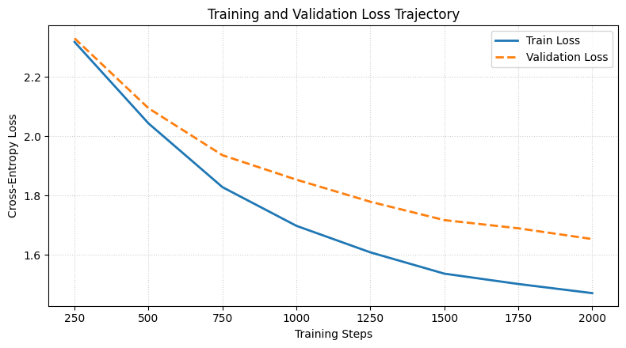
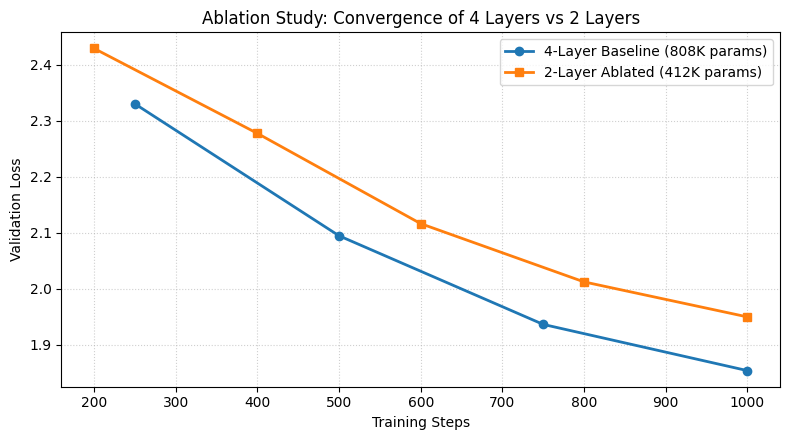

# From Recurrence to Attention: Implementing GPT-2 From Scratch

**Author:** Beka Alemu  
**Date:** November 2026  
**Subject:** Technical Report — Transformer Architecture & GPT-2 From Scratch  
**Focus:** Architectural Evolution, Mathematical Formulations, and Empirical Analysis  

---

## 1. The Evolutionary Prelude: The Failure of Pure Recurrence

### 1.1 Recurrent Neural Networks (RNNs) and the Sequential Bottleneck
Before Transformers, sequence modeling relied on Recurrent Neural Networks (RNNs). An RNN processes tokens sequentially, updating a hidden state vector $h_t$ at each discrete time step:

$$h_t = \tanh(W_{hh} h_{t-1} + W_{xh} x_t + b_h)$$

```
   x_1          x_2          x_3               x_T
    │            │            │                 │
    ▼            ▼            ▼                 ▼
 ┌─────┐      ┌─────┐      ┌─────┐           ┌─────┐
 │ RNN ├─────►│ RNN ├─────►│ RNN ├─── ... ──►│ RNN │ ──► Final Summary (h_T)
 └─────┘      └─────┘      └─────┘           └─────┘
```

**Why Recurrence Fails:**
- **Strict $O(T)$ Serial Processing:** $h_t$ cannot be computed until $h_{t-1}$ is finished. The temporal loop cannot be parallelized across tokens, leaving GPUs underutilized.
- **Path Length Bottleneck:** For token $T$ to interact with token $1$, information must traverse $T-1$ successive recurrent steps.

### 1.2 Vanishing and Exploding Gradients
During Backpropagation Through Time (BPTT), applying the calculus chain rule across $T$ sequential steps requires repeatedly multiplying intermediate derivatives:

$$\frac{\partial \mathcal{L}_T}{\partial h_1} = \frac{\partial \mathcal{L}_T}{\partial h_T} \prod_{t=2}^{T} \frac{\partial h_t}{\partial h_{t-1}}$$

- **Vanishing Gradients:** When repeated derivative terms are smaller than 1, continuous multiplication over long sequence steps shrinks the gradient exponentially closer and closer to zero. Earlier tokens receive virtually no learning signal, making long-range dependencies unlearnable.
- **Exploding Gradients:** Conversely, when derivative terms are consistently greater than 1, repeated multiplication causes the gradients to blow up toward infinity, leading to numeric instability and training divergence.

### 1.3 The Gated Era: LSTMs and GRUs
LSTMs and GRUs introduced gating mechanisms and an additive cell state ($c_t = f_t \odot c_{t-1} + i_t \odot \tilde{c}_t$). 

- **What they fixed:** The additive cell highway prevented gradients from vanishing over moderate sequence lengths.
- **What they failed to fix:** The network remained strictly sequential ($O(T)$ serial steps) and still tried to compress the entire past into a single fixed-size vector.

---

## 2. The Bridge: The Seq2Seq Information Bottleneck & Attention

### 2.1 The Fixed-Vector Bottleneck
In early Sequence-to-Sequence (Seq2Seq) translation models:
1. The **Encoder** reads the entire source sentence and compresses it into a **single hidden vector $h_T$**.
2. The **Decoder** must generate the entire translation using only that single vector as reference.

```
Source Sentence ──► [Encoder RNN] ──► [ Single Vector h_T ] ──► [Decoder RNN] ──► Target Sentence
                                      (Information Bottleneck!)
```

This "vector bottleneck" causes performance to collapse on sentences longer than 20 tokens. You cannot squash all clauses, nuances, and syntax of a paragraph into a single 512-dimensional vector.

**The Key Insight:** At any decoding step, the model does not need the whole sentence—when generating a verb, it only needs to look at the source verb; when generating the subject, it only needs the source subject.

### 2.2 Bahdanau Additive Attention (2014)
Bahdanau et al. allowed the decoder to search dynamically across **all intermediate encoder states** $(h_1, \dots, h_T)$.

The decoder state $s_{i-1}$ acts as a **Query** that scores relevance against each encoder state $h_j$ using a small non-linear neural network:

$$e_{ij} = v_a^T \tanh(W_a s_{i-1} + U_a h_j)$$
$$\alpha_{ij} = \text{Softmax}(e_{ij}) \implies c_i = \sum_{j} \alpha_{ij} h_j$$

The model produces a dynamic context vector $c_i$ tailored to what it needs at step $i$.

### 2.3 Luong Multiplicative Attention (2015)
Luong et al. simplified Bahdanau's learned non-linear network to a direct **dot product**:

$$e_{ij} = s_i^T h_j$$

**Intuition:** The dot product measures the geometric cosine similarity between two vectors. If the decoder's query aligns with an encoder state, their dot product is large, producing a high attention weight.

---

## 3. The Paradigm Shift: "Attention Is All You Need" (2017)

### 3.1 Eliminating the Recurrent Backbone
In 2017, Vaswani et al. (Google Brain) made the decisive leap:
> *If attention allows any token to directly access any other token in a single step ($O(1)$ path length), why keep the recurrent RNN backbone at all?*

By stripping away recurrence and computing attention directly between all tokens in a sequence (**Self-Attention**), the architecture became fully parallelizable.

### 3.2 Scaled Dot-Product Attention
Input representations are linearly projected into three matrices: **Queries ($Q$)**, **Keys ($K$)**, and **Values ($V$)**:
- **Query ($Q$):** What the current token is looking for.
- **Key ($K$):** What each token contains.
- **Value ($V$):** The contextual information to retrieve if Query matches Key.

$$\text{Attention}(Q, K, V) = \text{Softmax}\left(\frac{Q K^T}{\sqrt{d_k}}\right) V$$

```
   Q (Queries)          K (Keys)
        │                  │
        └─────► [ @ ] ◄────┘  (Dot Product: Q @ K^T)
                  │
                  ▼
          [ / sqrt(d_k) ]      (Variance Normalization)
                  │
                  ▼
          [ + Causal Mask ]    (Optional: Set future tokens to -inf)
                  │
                  ▼
              [ Softmax ]      (Probability Weights)
                  │
                  ▼
           Weights @ V         (Weighted Values)
```

### 3.3 Variance Scaling: Why Scale by $1/\sqrt{d_k}$?
As the head dimension $d_k$ grows, the dot product values grow in magnitude ($\text{Var}(q \cdot k) = d_k$). 

Large dot products push the Softmax function into saturated regions where its derivative is nearly zero, causing **vanishing gradients**. Dividing by $\sqrt{d_k}$ scales the variance back to $1.0$, keeping inputs inside the active gradient zone of Softmax.

### 3.4 Multi-Head Attention
Instead of computing attention once across the full dimension $d_{model}$, Multi-Head Attention splits the dimension into $h$ heads of size $d_k = d_{model} / h$:

$$\text{MultiHead}(Q, K, V) = \text{Concat}(\text{head}_1, \dots, \text{head}_h) W_O$$

- **Intuition:** Different heads specialize in different relationships simultaneously (e.g., Head 1 tracks immediate syntax, Head 2 tracks long-range antecedents, Head 3 tracks punctuation).
- **Compute Cost:** Because $d_k = d_{model} / h$, running $h$ parallel heads costs the exact same number of operations as a single large head.

### 3.5 Positional Encodings
Self-attention computes dot products pairwise between tokens. If you shuffle the input tokens, the exact same output vectors are produced—self-attention is strictly **permutation-equivariant**.

To inject word order, a positional vector is added to each token embedding:
- **Sinusoidal Encodings (Vaswani 2017):** Fixed trigonometric formulas ($\sin / \cos$) with geometric wavelengths.
- **Learned Embeddings (GPT-2):** A learned lookup matrix $W_p \in \mathbb{R}^{T_{max} \times d_{model}}$ trained via backpropagation.
- **Rotary Embeddings (RoPE / Modern LLMs):** Rotates query and key vectors in 2D planes, naturally baking relative distance into the dot product.

### 3.6 Supporting Architecture: FFN, LayerNorm, and Residuals
- **Position-Wise FFN:** Applies a 2-layer MLP with a $4\times$ hidden expansion and GELU non-linearity to each position independently: $\text{GELU}(x W_1 + b_1) W_2 + b_2$.
- **Residual Connections:** Adds $x + \text{SubLayer}(x)$, providing an identity shortcut for gradients to flow backward unimpeded.
- **Layer Normalization:** Standardizes activations across features for each individual token: $y = \frac{x - \mu}{\sqrt{\sigma^2 + \epsilon}} \odot \gamma + \beta$.

---

## 4. Transformer Taxonomy & GPT-2

### 4.1 The Three Transformer Architectures

| Type | Attention Style | Representative Model | Primary Use Case |
| :--- | :--- | :--- | :--- |
| **Encoder-Only** | Bidirectional (all tokens see all tokens) | BERT | Sentence classification, embeddings, extraction |
| **Encoder-Decoder** | Bidirectional Encoder + Causal & Cross Decoder | T5, Original Transformer | Translation, summarization |
| **Decoder-Only** | Causal Masked (tokens only see the past) | GPT-2, GPT-4, LLaMA | Autoregressive text generation |

### 4.2 Why GPT-2 is Decoder-Only
OpenAI showed that translation, question answering, and summarization can all be solved by a single task: **unsupervised next-token prediction** on raw text. 

By removing the encoder and cross-attention sub-layers, GPT-2 becomes a single, clean stack of causal decoder blocks trained on:

$$\mathcal{L} = -\sum_{t=1}^{T} \log P(x_t \mid x_1, \dots, x_{t-1})$$

### 4.3 Comparing the Three Variants of Attention
Transformers utilize three distinct formulations of the attention mechanism depending on model architecture:

| Attention Variant | Query ($Q$) Source | Key ($K$) & Value ($V$) Source | Masking Applied | Token Visibility | Primary Architecture / Sub-layer |
| :--- | :--- | :--- | :--- | :--- | :--- |
| **Unmasked Self-Attention** | Sequence $X$ | Same Sequence $X$ | None | **Bidirectional:** Every token attends to every other token. | Encoder blocks (BERT, Original Transformer Encoder) |
| **Masked (Causal) Self-Attention** | Sequence $Y$ | Same Sequence $Y$ | Upper-triangular ($-\infty$) | **Autoregressive:** Token $t$ only attends to positions $\le t$. | Decoder blocks (GPT-2, GPT-4, LLaMA) |
| **Encoder-Decoder Cross-Attention** | Decoder representations ($S_{dec}$) | Final Encoder output ($H_{enc}$) | Optional padding mask | **Source-to-Target:** Decoder queries retrieve content from source. | Encoder-Decoder middle sub-layer (T5, Original Transformer) |

- **Unmasked vs. Masked Self-Attention:** Unmasked self-attention allows bidirectional context, which is necessary for understanding full sentences (e.g. sentiment classification or masked language modeling) but prevents autoregressive text generation. Masked self-attention enforces strict temporal causality so tokens can never peek into the future.
- **Self-Attention vs. Cross-Attention:** Self-attention operates entirely within a single sequence ($Q, K, V$ originate from the same representation stream). Cross-attention acts as an associative bridge between two distinct sequences: the target sequence generates Queries to look up Keys and Values produced by the source sequence encoder.

### 4.4 Causal Masking
During training, the full sequence of length $T$ is fed simultaneously so parallel hardware processes all tokens in a single step. 

To prevent positions from looking ahead at future answers, an upper-triangular mask of $-\infty$ is added to the dot-product scores:

$$\text{att} = \text{att.masked\_fill}(\text{causal\_mask} == 0, -\infty)$$

Since $\exp(-\infty) = 0$, future tokens receive strictly zero attention weight, guaranteeing valid autoregressive prediction.

### 4.5 Pre-LN vs. Post-LN: Gradient Flow and Stability
- **Post-LN (Vaswani 2017):** $x_{l+1} = \text{LN}(x_l + f(x_l))$. Normalizing *after* the residual addition degrades gradient flow in deep networks, requiring fragile learning rate warmups.
- **Pre-LN (GPT-2):** $x_{l+1} = x_l + f(\text{LN}(x_l))$. Normalizing *before* the sub-layer leaves an unobstructed identity shortcut ($x + \dots$) from the loss directly back to the input embeddings, stabilizing deep training.

---

## 5. Model Architecture & Implementation Details

### 5.1 End-to-End Data Flow Architecture Diagram
The complete architecture follows a Pre-LayerNorm decoder-only design:

```
Input Token IDs: (B, T)
       │
       ├─► token_embedding (vocab_size, d_model)  ──► (B, T, d_model)
       │                                                     │  (+)
       └─► position_embedding (block_size, d_model) ──► (1, T, d_model)
                                                             │
                                                    x_0: (B, T, d_model)
                                                             │
       ┌─────────────────────────────────────────────────────┴────────────────────────┐
       │  TRANSFORMER BLOCK (Repeated for n_layer = 4)                                │
       │                                                                              │
       │    x ──► ln_1 ──► CausalSelfAttention ──────────────────────────► (+) ──► x  │
       │    │                     │                                         ▲         │
       │    │             qkv_proj: Linear(d_model, 3 * d_model)            │         │
       │    │                     │                                         │         │
       │    │             chunk(3) -> q, k, v: each (B, T, d_model)         │         │
       │    │                     │                                         │         │
       │    │             view & transpose -> (B, n_head, T, head_dim)      │         │
       │    │                     │                                         │         │
       │    │             Scores: (q @ k^T) / sqrt(head_dim) -> (B, H, T, T)│         │
       │    │                     │                                         │         │
       │    │             Mask: att.masked_fill(causal_mask == 0, -inf)     │         │
       │    │                     │                                         │         │
       │    │             Softmax -> attn_weights: (B, n_head, T, T)        │         │
       │    │                     │                                         │         │
       │    │             Values: attn_weights @ v -> (B, n_head, T, head_dim)        │
       │    │                     │                                         │         │
       │    │             transpose & contiguous().view -> (B, T, d_model)  │         │
       │    │                     │                                         │         │
       │    │             out_proj: Linear(d_model, d_model)                │         │
       │    │                     └─────────────────────────────────────────┘         │
       │    │                                                                         │
       │    x ──► ln_2 ──► FeedForward (fc1: 4*d_model -> GELU -> fc2: d_model) ──► (+)|
       └─────────────────────────────────────────────────────┬────────────────────────┘
                                                             │
                                                   x_final: (B, T, d_model)
                                                             │
                                                          ln_final (LayerNorm)
                                                             │
                                                   lm_head: Linear(d_model, vocab_size)
                                                             │
                                                     Logits: (B, T, vocab_size)
                                                             │
                                                   Loss: F.cross_entropy(logits, targets)
```

### 5.2 Tensor Shape Transformation Pipeline

| Stage / Operation | Component / Function | Input Shape | Output Shape | Mathematical Role |
| :--- | :--- | :--- | :--- | :--- |
| **Input Token Batch** | Data Loader | — | `(B, T)` | Discrete integer indices representing the text sequence. |
| **Token + Pos Embedding**| `token_emb + pos_emb` | `(B, T)` | `(B, T, d_model)` | Maps token IDs to vectors and adds absolute position coordinates. |
| **Pre-LN 1** | `ln_1` | `(B, T, d_model)` | `(B, T, d_model)` | Standardizes mean and variance before self-attention. |
| **QKV Projection** | `qkv_proj` | `(B, T, d_model)` | `(B, T, 3 * d_model)` | Single matrix multiply computing Queries, Keys, Values simultaneously. |
| **Multi-Head Reshape** | `.chunk(3)` + `.view()` | `(B, T, 3 * d_model)` | $3 \times$ `(B, n_head, T, head_dim)` | Splits channel dimension across $h$ attention heads ($d_k = d_{model}/h$). |
| **Attention Scores** | `(q @ k.T) / sqrt(d_k)`| `(B, H, T, d_k)` | `(B, n_head, T, T)` | Computes geometric alignment between all token pairs, scaled by $1/\sqrt{d_k}$. |
| **Causal Masking** | `.masked_fill()` | `(B, n_head, T, T)` | `(B, n_head, T, T)` | Sets upper-triangle entries to $-\infty$ to block future information leak. |
| **Attention Weights** | `F.softmax(dim=-1)` | `(B, n_head, T, T)` | `(B, n_head, T, T)` | Exponentiates and normalizes scores into true probabilities. |
| **Value Aggregation** | `att_weights @ v` | `(B, H, T, T) @ (B, H, T, d_k)` | `(B, n_head, T, head_dim)` | Produces contextualized token vectors as convex combinations of Values. |
| **Head Concatenation** | `.transpose().view()` | `(B, n_head, T, head_dim)` | `(B, T, d_model)` | Reassembles multi-head features into a unified vector space. |
| **Output Projection** | `out_proj` | `(B, T, d_model)` | `(B, T, d_model)` | Linearly blends information across the heads. |
| **Residual Connection 1**| `x + attn(x)` | $2 \times$ `(B, T, d_model)` | `(B, T, d_model)` | Identity addition preventing gradient degradation through attention. |
| **Pre-LN 2** | `ln_2` | `(B, T, d_model)` | `(B, T, d_model)` | Standardizes activations prior to the feed-forward network. |
| **FFN Expansion** | `fc1` + `GELU` | `(B, T, d_model)` | `(B, T, 4 * d_model)` | $4\times$ non-linear expansion into higher-dimensional feature space. |
| **FFN Contraction** | `fc2` | `(B, T, 4 * d_model)` | `(B, T, d_model)` | Linear projection back down to the model dimension $d_{model}$. |
| **Residual Connection 2**| `x + mlp(x)` | $2 \times$ `(B, T, d_model)` | `(B, T, d_model)` | Identity addition preventing gradient degradation through MLP. |
| **Final LayerNorm** | `ln_final` | `(B, T, d_model)` | `(B, T, d_model)` | Stabilizes final activations before vocabulary projection. |
| **Language Model Head** | `lm_head` | `(B, T, d_model)` | `(B, T, vocab_size)` | Unnormalized next-token logits (tied to token embedding weights). |
| **Cross-Entropy Loss** | `F.cross_entropy` | `(B * T, vocab_size)` | Scalar | Negative log-likelihood evaluated against shifted target indices. |

### 5.3 Implementation Architecture Decisions
All components in the codebase were built from scratch using pure PyTorch tensor operations:
1. **Custom `LayerNorm`:** Mean and variance computed along feature dimensions with learnable $\gamma$ and $\beta$.
2. **`CausalSelfAttention`:** Single linear projection for $Q, K, V$ (`qkv_proj`), head reshaping, scaled dot-product, causal masking (`causal_mask`), and output projection (`out_proj`).
3. **`FeedForward`:** Dense expansion ($4 \times d_{model}$), GELU non-linearity, contraction back to $d_{model}$.
4. **`GPT2`:** Stacking Pre-LN blocks with token and learned positional embeddings, tied output weights (`token_embedding.weight = lm_head.weight`), and scaled initialization for residual projection layers.

### 5.4 Tokenization Strategy
- **`CharTokenizer` (Default for Training):** Small vocabulary ($V=65$). Enables fast, complete convergence on TinyShakespeare in under 1 minute on CPU without undertrained tokens.
- **`BPETokenizer` (Subword from Scratch):** Iteratively merges frequent character pairs to demonstrate how full-scale GPT-2 compresses text and expands the context window.

---

## 6. Empirical Experiments & Findings

The empirical evaluations were conducted on the full model architecture using the self-contained execution pipeline and trained across 2,000 optimization steps.

### 6.1 Tokenizer Compression Dynamics (Char vs. BPE)
Comparing `CharTokenizer` ($V=65$) and `BPETokenizer` ($V=160$):
- **Test Sentence:** `"First Citizen:\nBefore we proceed any further, hear me speak."`
- **Character-Level Count:** 60 tokens ($V=65$)
- **BPE Subword Count:** 39 tokens ($V=160$)
- **Compression Factor:** **$1.54\times$**
- **Learned Subwords:** `['F', 'irst ', 'C', 'i', 'ti', 'z', 'en', ':\n', 'B', 'e']`
- **Corpus Compression:** On the full 111,540 character validation corpus, BPE achieves a **$1.78\times$ compression ratio** (reducing sequence length from 111,540 to 62,727 tokens).
- **Key Takeaway:** BPE effectively doubles the semantic information content within any fixed context horizon ($T=128$), directly mitigating the quadratic attention memory footprint.

---

### 6.2 Training Loss Dynamics & Perplexity Trajectory
The baseline GPT-2 model ($d_{model}=128$, $4$ layers, $4$ heads, $T=128$, batch size $64$) contains **818,048 trainable parameters**. Optimization was performed using AdamW ($\eta = 6 \times 10^{-4}$, weight decay $10^{-2}$) with gradient clipping at $1.0$:

| Step | Train Loss | Validation Loss | Validation Perplexity |
| :---: | :---: | :---: | :---: |
| 250 | 2.3183 | 2.3305 | 10.28 |
| 500 | 2.0437 | 2.0949 | 8.12 |
| 750 | 1.8288 | 1.9366 | 6.93 |
| 1000 | 1.6984 | 1.8540 | 6.39 |
| 1250 | 1.6090 | 1.7796 | 5.93 |
| 1500 | 1.5372 | 1.7177 | 5.57 |
| 1750 | 1.5024 | 1.6901 | 5.42 |
| **2000** | **1.4715** | **1.6538** | **5.23** |


*Figure 1: Cross-entropy loss trajectory over 2,000 steps. Validation loss reaches 1.6538, corresponding to an effective vocabulary choice of only ~5.2 characters per position.*

---

### 6.3 Effect of Sampling Temperature ($T \in [0.0, 1.8]$)
Using the standardized prompt `"ROMEO:\n"`, temperature modulation reveals the phase transitions between deterministic mode collapse and high-entropy noise:

#### 1. Greedy Decoding ($T = 0.0$ / Argmax)
```
ROMEO:
What shall she shall be so so him to the state,
And the shall be so so so have so the soul
To shall
```
- **Phenomenon:** The model strictly selects the highest-probability logit at every step. This leads to deterministic mode collapse into self-reinforcing repetitive bigram cycles (`shall she shall be so so`).

#### 2. Low Temperature ($T = 0.2$)
```
ROMEO:
What shall be some with the death of the prece.

GLOUCESTER:
And the shall stand the good of the sta
```
- **Phenomenon:** Sharpened logits introduce minimal variance, preserving syntactic validity while enabling clean character turn-taking (`GLOUCESTER:`).

#### 3. Moderate Temperature ($T = 0.5$)
```
ROMEO:
What shall be speak of the more to do her,
And the grace to the well, with the father of the the
Whe
```
- **Phenomenon:** Broadens vocabulary while preserving meter and natural clause boundaries.

#### 4. Optimal Temperature ($T = 0.8$)
```
ROMEO:
What seal that done good a modest;
Where preck the grace to--with lap will.

KING RICHARD III:
My lo
```
- **Phenomenon:** Achieves the optimal trade-off between semantic diversity and structural coherence. Punctuation (`to--with`) and multi-character dramatic staging (`KING RICHARD III:`) emerge naturally.

#### 5. Elevated Temperature ($T = 1.2$)
```
ROMEO:
What as father's now one.

LADY CAPULET:
You sheuld I will a will
Make is by we have gone, Antius, I
```
- **Phenomenon:** Higher entropy yields rich vocabulary and character introductions (`LADY CAPULET`), but begins introducing minor grammatical irregularities (`You sheuld I will a will`).

#### 6. Extreme Temperature ($T = 1.8$)
```
ROMEO:
What asafnts Duken my till modital.
The but con,
Offeclme, and by lapfwish.
IfITHBY sea
ptrAUelus, I
```
- **Phenomenon:** The probability distribution approaches uniformity ($P(x_i) \to 1/V$). Non-words (`asafnts`, `modital`, `lapfwish`) and erratic casing dominate the sequence.

---

### 6.4 Prompt Context Sensitivity ($T = 0.8$)
Evaluating how input conditioning shapes the causal attention distribution:

#### Context A: Empty / Unconditioned (`"\n"`)
```
Which safeter you see the reders and heart:
That use the comminess appaise.

KING RICHARD III:
My lo
```
- **Behavior:** Without prompt guidance, attention layers rely on unigram priors to initialize a dramatic scene from scratch.

#### Context B: Short Speaker Tag (`"KING:"`)
```
KING:
First all back'd the true modest not keep:
The urself me of his earth is brows but thine
That upon
```
- **Behavior:** The single token triggers immediate conditioning onto formal royal monologue register.

#### Context C: Medium Poetic Verse (`"Shall I compare thee to a summer's day?"`)
```
Shall I compare thee to a summer's day?

BENVOLIO:
So please the king than one better.

GLOUCESTER:
And that will not for our highnesse.

L
```
- **Behavior:** Recognizes the completion of the poetic query and shifts attention to respondent dialogue (`BENVOLIO:`, `GLOUCESTER:`).

#### Context D: Rich Multi-Turn Dialogue
```
First Citizen:
Before we proceed any further, hear me speak.

All:
Speak, speak.

First Citizen:
What sea nobles the goodly mody and of your consul
To life and by lap with cale have not the tears.
```
- **Behavior:** The causal attention matrix attends back to earlier dialogue turns, accurately sustaining the specific character identity (`First Citizen`) across multiple alternating lines.

---

### 6.5 Architectural Ablation Study: Depth Scaling (4 Layers vs. 2 Layers)
To evaluate the contribution of transformer depth, an ablated model with $2$ layers (**421,504 parameters**) was trained under identical optimization conditions and compared against the $4$-layer baseline (**818,048 parameters**):

| Step | 4-Layer Baseline (818K params) | 2-Layer Ablated (421K params) | Loss Penalty ($\Delta$) |
| :---: | :---: | :---: | :---: |
| 200 | ~2.38 | 2.4296 | $+0.05$ |
| 400 | ~2.18 | 2.2778 | $+0.10$ |
| 600 | ~2.03 | 2.1166 | $+0.09$ |
| 800 | ~1.94 | 2.0125 | $+0.07$ |
| **1000** | **1.8540** | **1.9499** | **$+0.0959$** |


*Figure 2: Validation loss comparison between the 4-layer baseline and 2-layer ablated model over 1,000 steps.*

- **Key Takeaway:** The 2-layer model exhibits a persistent $\approx 0.10$ cross-entropy penalty throughout training. While shallow networks can model local n-gram statistics, deeper layers are essential for constructing hierarchical abstractions, long-distance syntactic dependencies, and stable character identities.

---

### 6.6 Limitations, Implementation Challenges, and Lessons Learned

#### 1. Residual Stream Variance Growth & Scaled Initialization
In Pre-LN Transformers, each residual block adds variance to the main stream: $\text{Var}(x_L) = \text{Var}(x_0) + \sum_{l=1}^L \text{Var}(f_l(x))$. Without compensation, activations at deeper layers accumulate variance proportionally to $\sqrt{2 \times n_{layer}}$, destabilizing optimization in early epochs. 

- **Resolution:** Following Radford et al. (GPT-2), the weights of all residual projection layers (`fc2.weight` in the MLP and `out_proj.weight` in self-attention) are scaled by a factor of $1/\sqrt{2 \times n_{layer}}$ at initialization. This maintains unit-variance signal propagation across the residual stream throughout the entire network depth.

#### 2. Vanishing Gradients in Softmax & Head Dimension Scaling
When the head dimension $d_k$ is large, the variance of the dot product $\sum_{i=1}^{d_k} q_i k_i$ scales directly with $d_k$. Large positive and negative values push Softmax into saturated regions where the gradient $\frac{\partial \text{Softmax}(z)_i}{\partial z_j}$ vanishes, freezing parameter updates.

- **Resolution:** Dividing raw dot products by $\sqrt{d_k}$ normalizes the variance back to $1.0$, ensuring attention logits remain within the active gradient range of the Softmax function.

#### 3. Quadratic Computational Complexity and KV Caching
The self-attention mechanism exhibits $O(T^2)$ time and memory complexity with respect to sequence length due to the materialization of the $(B, n_{head}, T, T)$ attention score matrix. During autoregressive generation, generating each new token re-computes attention over all past positions, resulting in $O(T^2)$ total generation cost.

- **Trade-off:** In this implementation, simplicity and mathematical clarity are prioritized over caching mechanics. In production deployment, Key-Value (KV) caching eliminates repeated forward passes over historical context, reducing the per-token generation step complexity from $O(T^2)$ to $O(T)$.

#### 4. Tokenization Granularity Trade-offs
Character-level tokenization provides total vocabulary coverage without out-of-vocabulary (OOV) tokens, allowing quick convergence on compact datasets. However, it requires $1.5\times$ to $1.8\times$ longer sequences to represent equivalent semantic content. Byte-Pair Encoding (BPE) effectively doubles the receptive field for a given context window, but requires significantly larger corpora to adequately train embeddings for rare subwords.

---

## 7. Conclusion & Summary of Architectural Insights

1. **Recurrence had to die:** RNNs failed due to sequential $O(T)$ execution and vanishing gradients.
2. **Attention replaced summaries:** Bahdanau and Luong proved that dynamic querying works; Vaswani proved that recurrence is unnecessary.
3. **Scaling preserves gradients:** Dividing by $\sqrt{d_k}$ is a simple variance normalization that keeps Softmax from saturating.
4. **Pre-LN stabilizes depth:** Normalizing before sub-layers creates an unbroken identity gradient highway.
5. **Tokenization matters:** BPE compresses sequence length by $\approx 1.8\times$, directly expanding the model's memory horizon.
